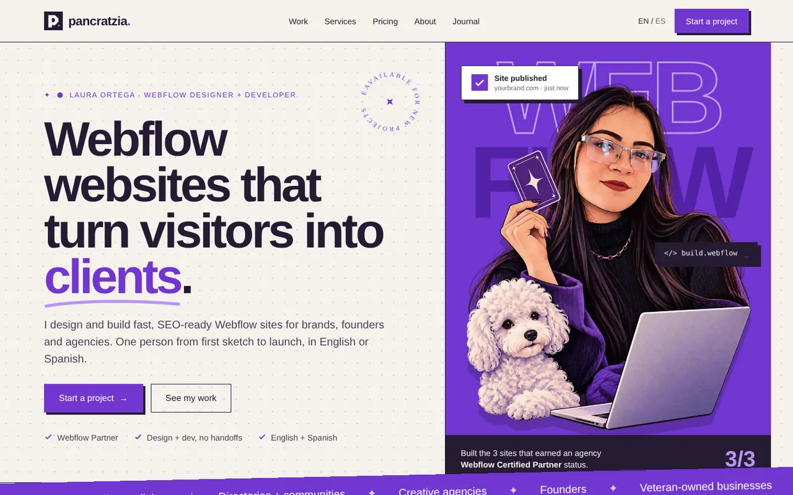
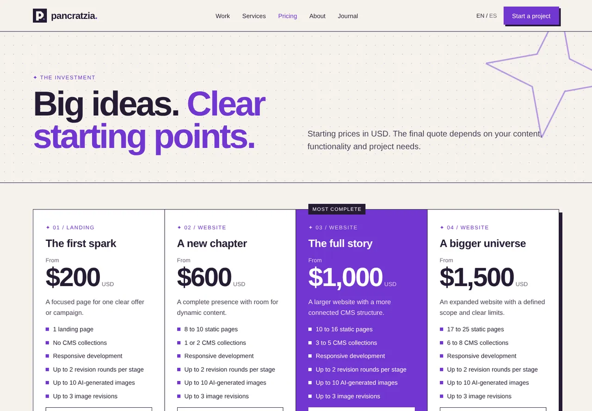
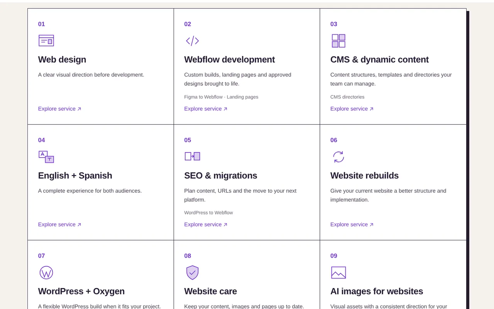
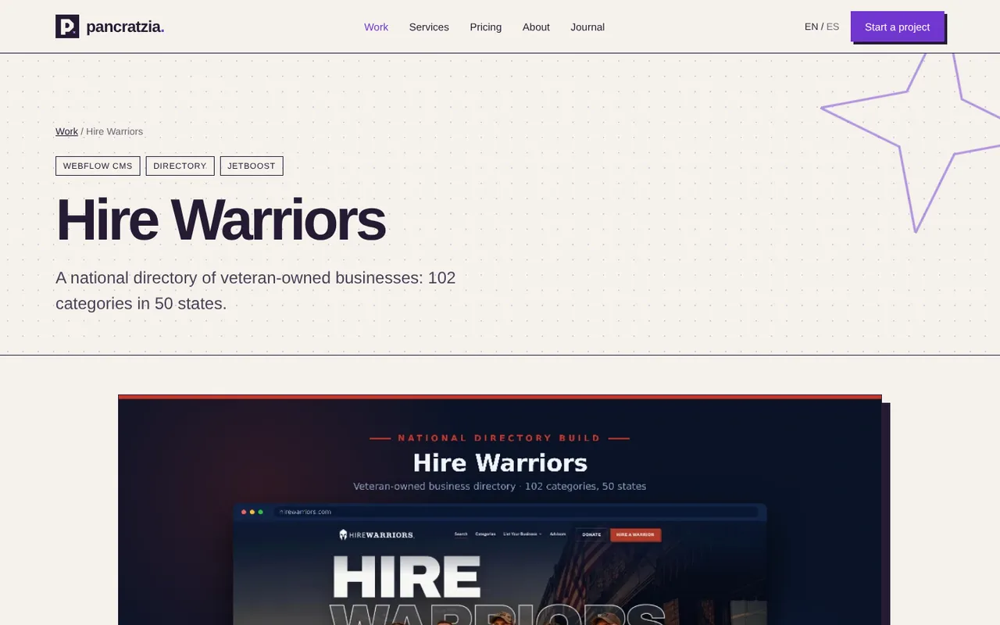
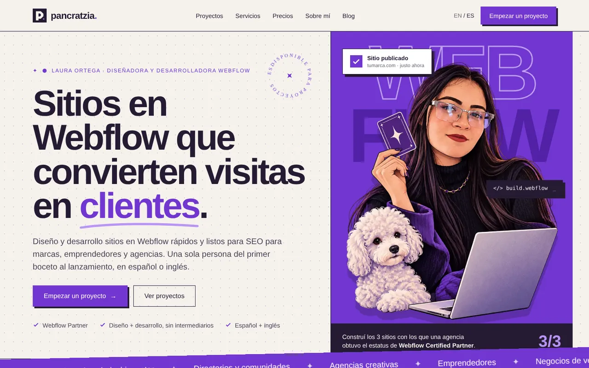
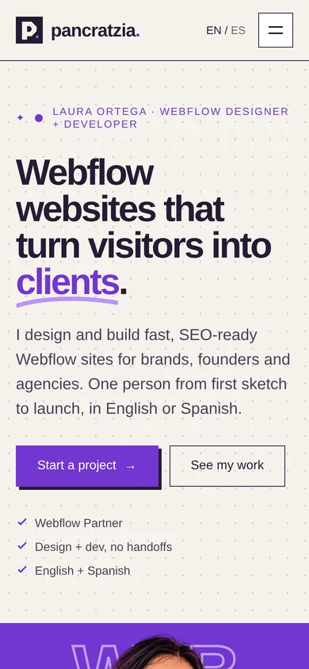
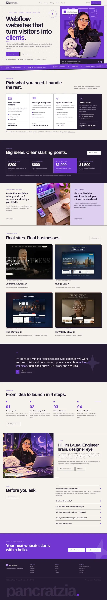
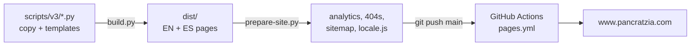

<div align="center">


# pancratzia.

**Webflow websites that turn visitors into clients.**<br>
Portfolio and studio site of **Laura Ortega**, Webflow designer + developer.

[](https://www.pancratzia.com)
[](https://github.com/Pancratzia/Portfolio/actions/workflows/pages.yml)
[](https://www.pancratzia.com/es/)

[**Visit the site**](https://www.pancratzia.com) · [Work](https://www.pancratzia.com/work/) · [Services](https://www.pancratzia.com/services/) · [Pricing](https://www.pancratzia.com/pricing/) · [Contact](mailto:me@pancratzia.com)

<br>



</div>

---

## ✦ A quick tour

<table>
<tr>
<td width="50%"><br><sub><b>Pricing</b> · four clear starting points, maintenance and add-ons</sub></td>
<td width="50%"><br><sub><b>Services</b> · nine services with dedicated pages</sub></td>
</tr>
<tr>
<td><br><sub><b>Case studies</b> · Joumana Kayrouz, Mungo Law, Hire Warriors, Her Vitality Clinic</sub></td>
<td><br><sub><b>Español</b> · every page has a Spanish version under <code>/es/</code></sub></td>
</tr>
</table>

<details>
<summary><b>📱 Mobile view</b></summary>
<br>
<p align="center"></p>
</details>

<details>
<summary><b>🖼️ Full homepage, top to bottom</b></summary>
<br>
<p align="center"></p>
</details>

---

## ✦ What's inside

| | |
|---|---|
| **66 pages** | 33 in English + 33 in Spanish, with `hreflang` pairs and automatic language detection |
| **Static & fast** | Plain HTML, one CSS file, one small JS file. No framework, no build step on the server |
| **SEO-ready** | Canonical URLs, Open Graph, `sitemap.xml` (with language alternates) and `robots.txt`, regenerated on every deploy |
| **Accessible** | Real links and buttons, skip link, visible focus, `prefers-reduced-motion` respected |
| **Analytics** | Google Tag Manager + GA4, injected once per page by `prepare-site.py` |
| **Contact** | Email-first: every CTA opens `me@pancratzia.com` with a ready subject line |

---

## ✦ How it works



<details>
<summary><b>📁 Project structure</b></summary>

```text
.
├── dist/                    ← the website (what gets published)
│   ├── index.html           ← home (EN)
│   ├── es/                  ← Spanish pages
│   ├── work/ services/ …    ← one folder per page
│   ├── assets/              ← images, logo, favicon
│   ├── site.css · site.js   ← all styles and scripts
│   └── sitemap.xml · robots.txt · locale.js
├── scripts/
│   ├── v3/                  ← page generator (edit copy and design here)
│   │   ├── core.py          ← header, footer, <head>, helpers t() / u()
│   │   ├── pages_home.py    ← homepage
│   │   ├── pages_main.py    ← work, cases, services hub, pricing, process, about, FAQ, contact, journal
│   │   ├── legacy.py        ← service details, articles, legal pages
│   │   ├── base.css · extra.css · site.js
│   │   └── build.py         ← builds dist/
│   ├── prepare-site.py      ← analytics, sitemap, 404 pages, language routing
│   ├── create_404.py
│   └── build-pages.py       ← used by GitHub Actions
├── docs/screenshots/        ← images for this README
└── .github/workflows/pages.yml
```

</details>

<details>
<summary><b>✏️ Editing the site</b></summary>

All copy lives in `scripts/v3/`. Each string is written in both languages with `t('English', 'Español')`, and internal links use `u('/path/')` so the Spanish version gets `/es/` automatically.

```sh
# 1. edit scripts/v3/*.py or the CSS
# 2. rebuild every page in EN + ES
python3 scripts/v3/build.py
# 3. add analytics, sitemap, 404s and language routing
python3 scripts/prepare-site.py
# 4. preview locally at http://localhost:8000
cd dist && python3 -m http.server 8000
```

Requirements for local builds: Python 3.12+, `beautifulsoup4` and `lxml` (`pip install beautifulsoup4 lxml`).

</details>

<details>
<summary><b>🚀 Publishing</b></summary>

Push to `main`. GitHub Actions (`.github/workflows/pages.yml`) runs `build-pages.py` and publishes `dist/` to GitHub Pages under **www.pancratzia.com**.

In the repository settings, **Pages → Build and deployment → Source** must be **GitHub Actions**. After a deploy, submit `https://www.pancratzia.com/sitemap.xml` in Google Search Console.

</details>

<details>
<summary><b>🎨 Design system</b></summary>

| Token | Value |
|---|---|
| Purple | `#7136d0` |
| Ink | `#251b33` |
| Paper | `#f5f2ec` |
| Lilac | `#ddd0ef` |
| Display font | Space Grotesk |
| Body font | DM Sans |
| Corners | Square. Always. |

</details>

<details>
<summary><b>🇪🇸 Leer en español</b></summary>
<br>

**pancratzia.** es el portafolio y estudio de **Laura Ortega**, diseñadora y desarrolladora Webflow. El sitio es HTML estático en español e inglés (66 páginas) y se publica en GitHub Pages en [www.pancratzia.com](https://www.pancratzia.com/es/).

- Para editar textos o diseño: `scripts/v3/` y luego `python3 scripts/v3/build.py` + `python3 scripts/prepare-site.py`.
- Para publicar: `git push` a `main`.
- Contacto: [me@pancratzia.com](mailto:me@pancratzia.com).

</details>

---

<div align="center">
<sub>Thoughtfully designed. Carefully built. · © 2026 Laura Ortega · <a href="https://webflow.com/@pancratzia">Webflow</a> · <a href="https://www.linkedin.com/in/leortegaperez/">LinkedIn</a></sub>
</div>
